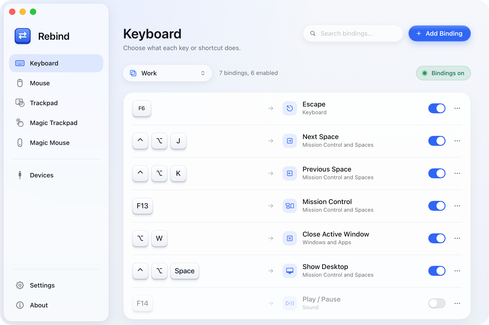
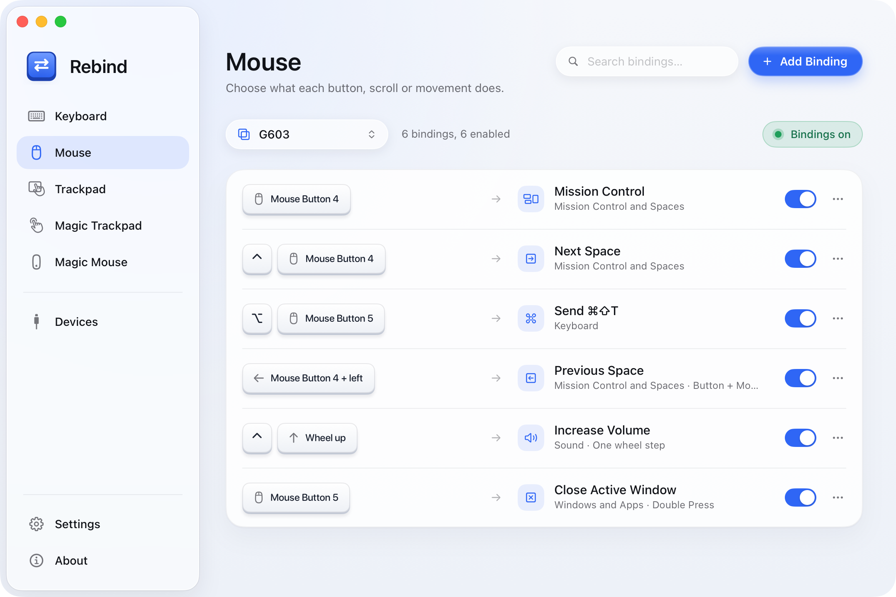
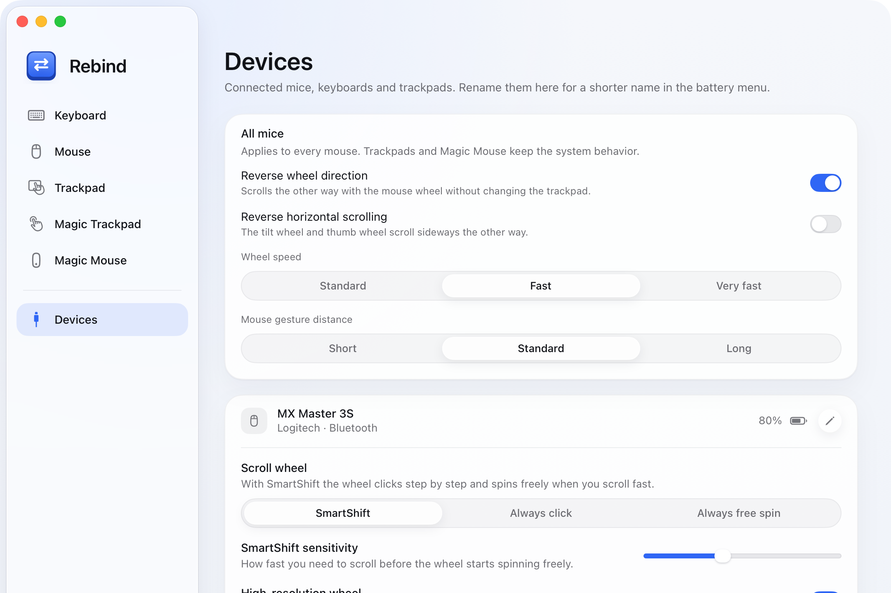
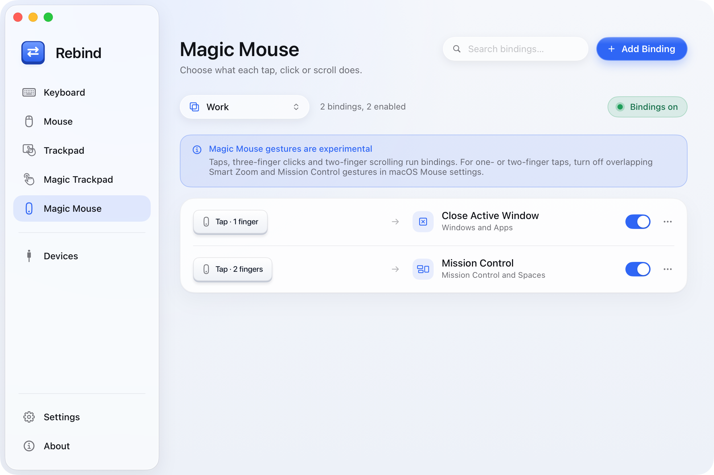
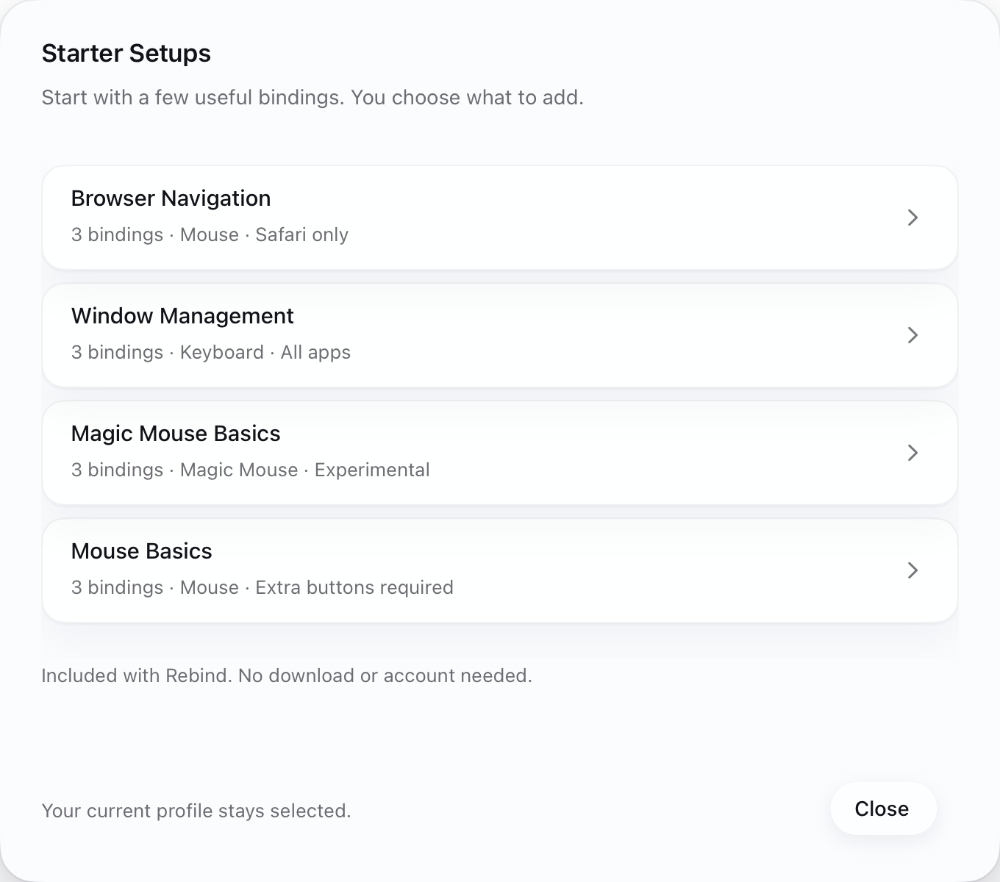

<div align="center">
  
  <h1>Rebind</h1>
  <p><strong>Native macOS input remapper for keyboards, multi-button &amp; Logitech HID++ mice, smooth scrolling, Trackpad, and Magic Mouse.</strong></p>
  <p>
    <a href="https://rebind.moduix.dev"></a>
    <a href="https://github.com/Blinks44/rebind/releases/latest"></a>
    
    
    <a href="LICENSE"></a>
  </p>
  <p>
    <a href="https://rebind.moduix.dev">Website</a> ·
    <a href="#installation">Install</a> ·
    <a href="#features">Features</a> ·
    <a href="docs/CAPABILITIES.md">Capabilities</a> ·
    <a href="docs/USAGE.md">User Guide</a> ·
    <a href="CHANGELOG.md">Changelog</a>
  </p>
</div>

<p align="center">
  <picture>
    <source media="(prefers-color-scheme: dark)" srcset="docs/images/rebind-dark.webp" />
    
  </picture>
</p>

<details>
<summary><strong>More screenshots (Mouse, Logitech HID++ &amp; Smooth Scroll, Magic Mouse, Starter Setups)</strong></summary>

<br />

| Mouse &amp; Gesture Rules | Logitech HID++ &amp; Per-Mouse Scroll |
| --- | --- |
| <picture><source media="(prefers-color-scheme: dark)" srcset="apps/website/public/screenshots/mouse-dark.webp" /></picture> | <picture><source media="(prefers-color-scheme: dark)" srcset="apps/website/public/screenshots/devices-dark.webp" /></picture> |

| Magic Mouse (Experimental) | Built-In Offline Starter Setups |
| --- | --- |
| <picture><source media="(prefers-color-scheme: dark)" srcset="apps/website/public/screenshots/magic-mouse-dark.webp" /></picture> | <picture><source media="(prefers-color-scheme: dark)" srcset="apps/website/public/screenshots/starter-setups-dark.webp" /></picture> |

</details>

---

## Why Rebind

Rebind brings keyboard remapping, extra mouse buttons, drag gestures, per-mouse smooth scrolling, Logitech HID++ hardware controls, and curated touch gestures into **one fast native Swift app**—without Electron, heavy vendor suites, accounts, or telemetry.

- **Accessibility only** — never asks for Input Monitoring, never logs keystrokes, and starts paused with zero bindings.
- **Fail-open by design** — press **⌃⌥⇧⌘ Escape** anytime to pause all rules immediately; errors fall back to normal macOS input.
- **100% local** — rules and profiles stay in plain JSON inside `~/Library/Application Support/Rebind` with automatic rolling backups.

---

## Installation

Requires **macOS 15 Sequoia or later** (Universal binary).

### Homebrew (recommended)

```sh
brew install --cask blinks44/tap/rebind
```

### Direct download

1. Download [`Rebind.dmg`](https://github.com/Blinks44/rebind/releases/latest/download/Rebind.dmg) from the [latest release](https://github.com/Blinks44/rebind/releases/latest) (optional verification via [`SHA256SUMS.txt`](https://github.com/Blinks44/rebind/releases/latest/download/SHA256SUMS.txt)).
2. Open the DMG and drag **Rebind** into **Applications**.
3. Follow the first-run guide to grant **Accessibility** permission.

> **First launch note:** Rebind is signed with a stable certificate so Accessibility permissions survive updates, but is not yet notarized by Apple. If macOS blocks the first launch, click **Open Anyway** in **System Settings → Privacy & Security**, or clear the quarantine attribute:
>
> ```sh
> xattr -dr com.apple.quarantine /Applications/Rebind.app
> ```

---

## Features

**Triggers**

- **Keyboard:** physical keys and shortcuts with **Press**, **Double Press**, and **Hold** (with optional separate short-press action).
- **Mouse:** Button 4/5+, middle click, extra gaming mouse buttons, **Button + Movement** gestures (4 directions), and **Button + Wheel** chords.
- **Trackpad &amp; Magic Trackpad (Experimental):** 12 curated presets including 3-/4-finger taps, 2-finger double taps, multi-finger clicks, and corner taps, with optional held modifier key.
- **Magic Mouse (Experimental):** 8 curated presets including 2-finger taps/clicks, side taps, and 3-finger scroll.

**Hardware &amp; Scrolling**

- **Independent wheel direction:** reverse vertical and horizontal mouse scrolling without affecting trackpad natural scrolling.
- **Per-mouse smooth scrolling:** tune glide strength (*Gentle*, *Standard*, *Strong*) and wheel speed separately per mouse.
- **Logitech HID++ 2.0:** configure pointer speed (DPI), SmartShift mode and sensitivity, High-resolution wheel, Gesture button, live menu bar battery charge, and compatible keyboard lighting (e.g. G915 TKL). Warns when Logi Options+ or G HUB is active.

**Actions &amp; Profiles**

- **Unified action catalog:** shortcuts, named macOS commands, modifier holds, mouse clicks/scroll, Insert Text (stored locally in plain text), window tiling (halves, quarters, Fill, Center, Fill with Left Margin, Fill Centered, next display), Mission Control &amp; Spaces, media/volume/brightness, lock/sleep, open app/file/URL, Apple Shortcuts, pause/profile switch.
- **Profiles &amp; Starter Setups:** per-app rules, excluded apps (e.g. games/VMs), manual profile switching from the menu bar, JSON import/export, and **4 built-in offline Starter Setups** (*Browser Navigation*, *Window Management*, *Magic Mouse Basics*, *Mouse Basics*) with trigger &amp; conflict preview.
- **Menu bar &amp; updates:** live multi-device battery percentages, inline DPI slider, Ed25519-signed [Sparkle](https://sparkle-project.org) updates, and 6 UI languages (English, Russian, German, French, Spanish, Simplified Chinese).

> **Honest scope:** Caps Lock and Fn remapping, Magic Mouse swipes/holds, trackpad swipes/pinch/rotate, and the Logitech thumb wheel as a trigger are not supported. Trackpad and Magic Mouse touch capture rely on private macOS APIs and are marked **Experimental**. See [docs/CAPABILITIES.md](docs/CAPABILITIES.md) for the full hardware verification matrix.

---

## Repository Layout

| Path | Contents |
| --- | --- |
| `apps/rebind/` | Native macOS app (Xcode project, Swift 6 sources, local `HIDPP` package, Swift Testing suite, `scripts/dev.sh`, `scripts/release.sh`) |
| `apps/website/` | Public landing page ([rebind.moduix.dev](https://rebind.moduix.dev)): TanStack Start, React 19, `@moduix/react`, Paraglide i18n, Cloudflare Workers |
| `docs/` | Product spec, design guidelines, capability matrix, user/dev/release guides, and verification records |

---

## Build From Source

Requires full Xcode with a **Swift 6.2+ compiler** and a **macOS 26+ SDK**.

```sh
apps/rebind/scripts/dev.sh doctor   # check Xcode toolchain & targets
apps/rebind/scripts/dev.sh run      # build Debug and launch Rebind.app
apps/rebind/scripts/dev.sh test     # run Swift Testing suite
```

You can also open `apps/rebind/rebind.xcodeproj` in Xcode, select the **rebind** scheme, and press **⌘R**. See [docs/DEVELOPMENT.md](docs/DEVELOPMENT.md) and [docs/RELEASING.md](docs/RELEASING.md) for signing and DMG packaging details.

---

## Technology

| Area | Stack |
| --- | --- |
| Language &amp; UI | Swift 6 language mode, SwiftUI, AppKit, Observation |
| Input &amp; Actions | Quartz Event Services (CGEventTap), Accessibility, NSWorkspace, Core Audio, IOKit |
| Mice &amp; HID++ | IOKit HID, Logitech HID++ 2.0 via vendored `HIDPP` package |
| Storage &amp; Updates | Atomic versioned JSON, String Catalogs (6 languages), [Sparkle 2](https://sparkle-project.org) (Ed25519 signed) |

---

## Acknowledgements

Full third-party licenses live in [NOTICE.txt](NOTICE.txt) and [ThirdPartyNotices.txt](apps/rebind/rebind/Resources/ThirdPartyNotices.txt).

- [Sparkle](https://github.com/sparkle-project/Sparkle) (MIT) — signed in-app updates.
- [LinearMouse](https://github.com/linearmouse/linearmouse) (MIT) — vendored `HIDPP` package, smooth scrolling glide approach, and high-res scroll reversal scaling.
- [Solaar](https://github.com/pwr-Solaar/Solaar) (GPL-2.0) — HID++ SmartShift &amp; device name payload reference only (no code copied).
- [Hammerspoon](https://github.com/Hammerspoon/hammerspoon) (MIT), [spacekit](https://github.com/cehbz/spacekit) (MIT), [Sanne](https://github.com/anandghegde/sanne) (MIT), and [Subsurface](https://github.com/mrkai77/Subsurface) (Apache-2.0).

---

## Also by Sergey V.

- [**Hearth**](https://hearth.moduix.dev) — Local dev environment dashboard for runtimes, projects, Docker, Kubernetes, databases, and AI agents.
- [**Monny**](https://monny.moduix.dev) — Native macOS system monitor for CPU, memory, disk, network, Apple silicon sensors, and AI usage quotas.

---

## License

Released under the [MIT License](LICENSE). Made by Sergey V. ([@TheBlinks182](https://x.com/TheBlinks182)).
