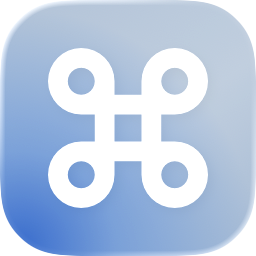

# Rebind



A native macOS utility for mapping keyboard and mouse input to shortcuts and system actions. Create a binding, choose its trigger and action, and keep it running from the menu bar while you work in other apps.

Rebind targets **macOS 26+**, with SwiftUI/AppKit and a modern design direction using Liquid Glass, depth and restrained gradients. Rules stay on your Mac; no account, cloud backend or analytics are required.

**Status:** under active development. Keyboard/mouse remapping and many action paths are implemented; full hardware, reliability and UI acceptance are still in progress. Trackpad support is experimental. See the [capability matrix](docs/CAPABILITIES.md) for tested subsets and limits.

## Features

- Keyboard and middle/extra mouse-button bindings with Command, Control, Option and Shift modifiers.
- Ordinary, double-press and long-press activation; discrete scroll-wheel triggers and mouse-button-held movement in four directions.
- Actions for keyboard shortcuts, mouse clicks, volume/media controls, windows, application switching, opening apps/files/web addresses, Apple Shortcuts and system operations.
- Named profiles with manual selection, independent rule sets and local persistence.
- Menu-bar controls to open Rebind, select a profile, pause/resume bindings and quit. Closing the main window keeps the app running.
- English, Russian, German and French translations; System Default or manual selection, applied after quitting and reopening Rebind.

Profiles apply to input categories rather than individual physical devices. Caps Lock/Fn remapping, held/repeating output, Magic Mouse gestures and external-trackpad support are not currently available. The integrated built-in four-finger tap is experimental, with recognition/recovery checks still open; native trackpad gestures remain active. First-run setup and permission recovery are implemented. General, Permissions, Input and Language settings are implemented, including Launch at Login through ServiceManagement and per-binding Hold timing; actual login/relaunch and complete localization/accessibility acceptance remain open. Advanced/About and import/export/reset are unfinished.

## Requirements

- macOS **26 or later**.
- Full Xcode with a **Swift 6.2+ compiler** and a **macOS 26+ SDK** to build from source.
- Accessibility and event-sending access for recording/remapping.

The project has been built and inspected on Apple Silicon with a newer macOS/Xcode toolchain. macOS 26 and Intel execution remain unverified; a universal Release build alone does not establish runtime compatibility.

## Build and run

From the repository directory:

```sh
scripts/dev.sh doctor
scripts/dev.sh run
```

`doctor` reports the selected toolchain and project targets. `run` builds Debug and opens `Rebind.app`. The script selects full Xcode per process without changing your system's `xcode-select` setting.

Alternatively, open `rebind.xcodeproj` in Xcode, select the **rebind** scheme and run with **⌘R**. Local development builds can use **Sign to Run Locally**; rebuilds may require renewing macOS permission grants.

To build a Release app:

```sh
scripts/dev.sh release
```

The result is `build/DerivedData/Build/Products/Release/Rebind.app`. Distribution signing and notarization are not complete. See the [development guide](docs/DEVELOPMENT.md) for toolchain overrides, tests and signing details.

## First launch

1. Open Rebind. New configurations start paused with no bindings.
2. Use first-run setup or **Settings → Permissions** to open **System Settings → Privacy & Security → Accessibility** and enable the running Rebind copy. Refresh the status and relaunch if macOS requests it.
3. If Accessibility is granted but event sending remains unavailable, use **Allow Event Sending**, then refresh. Recording/remapping require the actual checks to succeed.
4. Select an input category, add a binding, choose its trigger and action, save, and resume bindings.

For example, map **Control + Mouse Button 4 → Command+A** or assign a long press on an extra mouse button to a shortcut. Unmatched inputs retain normal system behavior.

Pause from the menu bar whenever needed. While capture is active, **⌃⌥⇧⌘ Escape** is the emergency pause shortcut. The current engine does not require a separate Input Monitoring grant; additional action-specific permission needs are explained by the relevant feature.

## How it works

The selected profile supplies the active bindings. A global Quartz event tap captures supported keyboard/mouse input and a bounded matcher decides whether to pass it through or trigger an action. Actions run separately from the synchronous event callback; synthesized events are tagged to prevent feedback loops. The experimental trackpad path uses an isolated private multitouch adapter.

Configuration is stored locally at `~/Library/Application Support/Rebind/configuration.json` using versioned JSON and atomic writes. Typed text is not logged or persisted. Secure Input and permission/lifecycle checks guard recording and dispatch.

## Technology

| Area | Stack |
| --- | --- |
| Language and UI | Swift 6 language mode, SwiftUI, AppKit, Observation |
| Input | Core Graphics / Quartz Event Services, owned Core Foundation run loop |
| Actions | Accessibility, NSWorkspace, Core Audio, IOKit, native Shortcuts CLI |
| Storage and localization | Codable/JSON, atomic local files, String Catalogs |
| Tests | Swift Testing with an Xcode-hosted test target |
| Build and assets | Xcode, SF Symbols, Sketch, Icon Composer |

The app target has no Swift package dependency. Some experimental trackpad/Dock/lock paths use private macOS APIs and carry compatibility limits. The standalone research probe has separate pinned dependencies. [Third-party notices](rebind/Resources/ThirdPartyNotices.txt) document credited sources.

## Documentation

- [Development guide](docs/DEVELOPMENT.md) — build, tests, signing and detailed local setup.
- [Capabilities](docs/CAPABILITIES.md) — implementation status, verified subsets and limitations.
- [Specification](docs/SPEC.md) and [roadmap](docs/PLAN.md) — product requirements and remaining work.
- [Documentation index](docs/README.md) — design, architecture conventions, verification and contributor/agent workflow.
