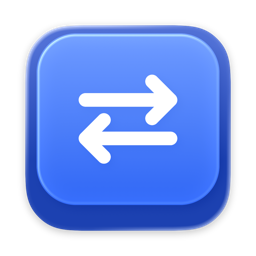

<p align="center">
  
</p>

<h1 align="center">Rebind</h1>

<p align="center">
  Remap keys, mouse buttons and trackpad gestures to shortcuts and macOS actions.<br>
  Free, open source, native on macOS 26+.
</p>

A native macOS utility for mapping keyboard and mouse input to shortcuts and system actions. Create a binding, choose its trigger and action, and keep it running from the menu bar while you work in other apps.

Rebind targets **macOS 26+**, with SwiftUI/AppKit and a calm, soft native design built on a shared design system. Rules stay on your Mac; no account, cloud backend or analytics are required.

**Status:** under active development. Keyboard/mouse remapping and many action paths are implemented; full hardware, reliability and UI acceptance are still in progress. Trackpad and Magic Mouse gesture support are experimental. See the [capability matrix](docs/CAPABILITIES.md) for tested subsets and limits.

## Repository layout

| Path | Contents |
| --- | --- |
| `apps/rebind/` | The macOS app: Xcode project, sources, tests, the `scripts/dev.sh` build script and developer tools |
| `apps/website/` | The public landing page (TanStack Start on Rsbuild); see its README |
| `docs/` | Specification, design notes, roadmap, current state and verification records |
| `AGENTS.md`, `.agents/` | Instructions and skills for coding and design agents |

## Features

**Triggers**

- Keyboard keys and shortcuts; middle and extra mouse buttons, with Command, Control, Option and Shift.
- Press, double press and hold. A hold binding can also send a shortcut on a short press.
- Mouse wheel steps, a held button plus movement in four directions, and a held button plus the wheel.
- Trackpad taps with three or four fingers, double taps, clicks with two to four fingers and corner taps, each optionally with one held modifier key. The built-in trackpad and an external Magic Trackpad have separate bindings.
- Experimental Magic Mouse one- and two-finger taps, with an optional held modifier and the shared action catalog. App hardware acceptance is pending; native Smart Zoom and Mission Control can also respond to repeated taps.

**Actions**

- Keyboard shortcuts, kept pressed and repeated while the trigger is held if you choose; named commands such as Copy, Paste, Undo, Back, Forward, tab and zoom commands and screenshots.
- Hold Command, Option, Control or Shift from a mouse button or key.
- Insert text, mouse clicks and scrolling, or do nothing to switch a key off.
- Windows: halves, quarters, fill, center, move to the next display, close, minimize, full screen, next and previous window.
- Apps and system: open, activate or quit an app, previous app, open a file, folder or web address, Apple Shortcuts, Mission Control and desktops, volume, media keys, display brightness, sleep and lock.
- Rebind itself: pause, next and previous profile.

**Everything else**

- Named profiles with manual selection; duplicate a binding, copy it to another profile, give it a note; export and import single profiles or a full backup.
- Bindings for all apps or for one app, which then replaces the general binding with the same trigger there.
- Excluded apps, such as games and virtual machines, with bindings and smooth scrolling switched off separately.
- Reverse vertical and horizontal scrolling separately, speed up the wheel, smooth scrolling set per mouse, adjustable mouse gesture distance.
- Logitech mice: SmartShift wheel mode and sensitivity, pointer resolution (DPI), high-resolution wheel, battery charge, and the gesture button as a trigger; kept per model and restored when the mouse connects; a warning while a vendor app such as Logi Options+ or G HUB may take over the mouse.
- A daily copy of the settings for the last week, besides full export and import.
- Runs from the menu bar with a paused state you can see, optional Dock icon, launch at login and an emergency pause shortcut.
- English, Russian, German, French, Spanish and Simplified Chinese.

Profiles apply to input categories rather than individual physical devices. Not available: Caps Lock and Fn remapping, Magic Mouse swipes/holds, trackpad swipes, pinch and rotation, and the Logitech thumb wheel as a trigger (it scrolls sideways as usual). Trackpad and Magic Mouse touch capture rely on a private macOS interface and are experimental; macOS gestures stay active, so the system may respond to the same tap. Much of the feature set is verified by automated tests only; see the [capability matrix](docs/CAPABILITIES.md) for what has been tried on real hardware.

## Requirements

- macOS **26 or later**.
- Full Xcode with a **Swift 6.2+ compiler** and a **macOS 26+ SDK** to build from source.
- Accessibility and event-sending access for recording/remapping.

The project has been built and inspected on Apple Silicon with a newer macOS/Xcode toolchain. macOS 26 and Intel execution remain unverified; a universal Release build alone does not establish runtime compatibility.

## Install

Rebind is free and open source. It is signed by the maintainer but **not notarized by Apple** (notarization requires a paid developer membership), so macOS asks you to confirm the first launch.

1. Download the latest `Rebind-….dmg` from the [Releases](../../releases) page and open it.
2. Drag **Rebind** onto the **Applications** folder, then open it from there. macOS shows a warning that it could not verify the app; close the warning.
3. Open **System Settings → Privacy & Security**, scroll down to the message about Rebind and click **Open Anyway**, then confirm.
4. Rebind opens and guides you through the one permission it needs, **Accessibility**.

You do this once. Updates are signed with the same certificate, so the Accessibility permission stays in place; after downloading an update, macOS asks for the **Open Anyway** confirmation again.

Prefer the terminal? This removes the download flag instead of step 3:

```sh
xattr -dr com.apple.quarantine /Applications/Rebind.app
```

If you would rather not trust a prebuilt app, build it yourself from this repository (below).

## Build and run

From the repository directory:

```sh
apps/rebind/scripts/dev.sh doctor
apps/rebind/scripts/dev.sh run
```

`doctor` reports the selected toolchain and project targets. `run` builds Debug and opens `Rebind.app`. The script selects full Xcode per process without changing your system's `xcode-select` setting.

Alternatively, open `apps/rebind/rebind.xcodeproj` in Xcode, select the **rebind** scheme and run with **⌘R**. Local development builds can use **Sign to Run Locally**; rebuilds may require renewing macOS permission grants.

To build a Release app:

```sh
apps/rebind/scripts/dev.sh release
```

The result is `apps/rebind/build/DerivedData/Build/Products/Release/Rebind.app`. To package a release for other people, use `apps/rebind/scripts/release.sh` (see the development guide). See the [development guide](docs/DEVELOPMENT.md) for toolchain overrides, tests and signing details.

## First launch

1. Open Rebind. New configurations start paused with no bindings.
2. Use first-run setup or **Settings → Permissions** to open **System Settings → Privacy & Security → Accessibility** and enable the running Rebind copy. Refresh the status and relaunch if macOS requests it.
3. If Accessibility is granted but event sending remains unavailable, use **Allow Event Sending**, then refresh. Recording/remapping require the actual checks to succeed.
4. Select an input category, add a binding, choose its trigger and action, save, and resume bindings.

For example, map **Control + Mouse Button 4 → Command+A** or assign a long press on an extra mouse button to a shortcut. Unmatched inputs retain normal system behavior.

Pause from the menu bar whenever needed. While capture is active, **⌃⌥⇧⌘ Escape** is the emergency pause shortcut. The current engine does not require a separate Input Monitoring grant; additional action-specific permission needs are explained by the relevant feature.

## How it works

The selected profile supplies the active bindings. A global Quartz event tap captures supported keyboard/mouse input and a bounded matcher decides whether to pass it through or trigger an action. Actions run separately from the synchronous event callback; synthesized events are tagged to prevent feedback loops. The experimental trackpad path uses an isolated private multitouch adapter.

Configuration is stored locally at `~/Library/Application Support/Rebind/configuration.json` using versioned JSON and atomic writes. Typed text is not logged or persisted. Secure Input and permission/lifecycle checks guard recording and dispatch.

## Technology

| Area | Stack |
| --- | --- |
| Language and UI | Swift 6 language mode, SwiftUI, AppKit, Observation |
| Input | Core Graphics / Quartz Event Services, owned Core Foundation run loop |
| Actions | Accessibility, NSWorkspace, Core Audio, IOKit, native Shortcuts CLI |
| Mice | IOKit HID, Logitech HID++ 2.0 through the vendored HIDPP package |
| Storage and localization | Codable/JSON, atomic local files, String Catalogs |
| Tests | Swift Testing with an Xcode-hosted test target |
| Build and assets | Xcode, SF Symbols, Sketch, Icon Composer |

The app target's only Swift package is the vendored local `HIDPP` package (`apps/rebind/Packages/HIDPP`). Some experimental trackpad/Dock/lock paths and the high-resolution wheel adjustment use private macOS APIs and carry compatibility limits. The standalone research probe has separate pinned dependencies. [Third-party notices](apps/rebind/rebind/Resources/ThirdPartyNotices.txt) document credited sources.

## Acknowledgements

Rebind builds on the work of these open-source projects. Each is credited with its license in [ThirdPartyNotices.txt](apps/rebind/rebind/Resources/ThirdPartyNotices.txt), which the app also shows under About.

- [LinearMouse](https://github.com/linearmouse/linearmouse) (MIT): the vendored `HIDPP` package for Logitech HID++, the approach of the smooth scrolling glide, and scaling the HID event attached to a scroll event so that reversing works on high-resolution wheels.
- [Solaar](https://github.com/pwr-Solaar/Solaar) (GPL-2.0): its HID++ feature documentation informed the SmartShift and device name payloads. Reference only; no code was copied.
- [Hammerspoon](https://github.com/Hammerspoon/hammerspoon) (MIT): media key events, the screen lock entry point and window raising were checked against it.
- [spacekit](https://github.com/cehbz/spacekit) (MIT): the Control+Arrow events for switching desktops.
- [Sanne](https://github.com/anandghegde/sanne) (MIT): the corner regions for one-finger corner taps.
- [Subsurface](https://github.com/mrkai77/Subsurface) (Apache-2.0): the private multitouch signatures and contact layout used by the trackpad adapter were compared with it.

## Documentation

- [Development guide](docs/DEVELOPMENT.md): build, tests, signing and detailed local setup.
- [Capabilities](docs/CAPABILITIES.md): implementation status, verified subsets and limitations.
- [Specification](docs/SPEC.md) and [roadmap](docs/PLAN.md): product requirements and remaining work.
- [Documentation index](docs/README.md): design, architecture conventions, verification and contributor/agent workflow.
- [Contributing](CONTRIBUTING.md), [security policy](SECURITY.md), [code of conduct](CODE_OF_CONDUCT.md) and [changelog](CHANGELOG.md).

## License

Rebind is released under the [MIT License](LICENSE): you may use, change and redistribute it, including in forks, as long as the copyright notice and the license text stay with every copy. Bundled third-party notices are in [ThirdPartyNotices.txt](apps/rebind/rebind/Resources/ThirdPartyNotices.txt).
