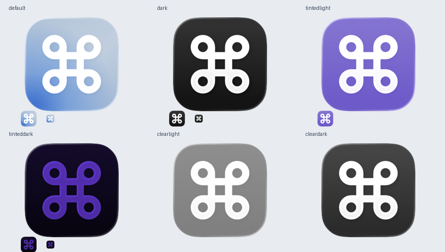

# Native app-icon integration — 2026-10-10

Scope: SPEC §10 Application icon / PLAN Phase 8. User authorized delivery of the finished Sketch icon through Icon Composer and Xcode. No app logic, rules, configuration, permissions or engine behavior changed.

## Delivery

Created and saved `rebind/AppIcon.icon` through Icon Composer UI. User accepted the first-launch Apple license directly. macOS only; watchOS disabled. Existing synchronized source folder and `ASSETCATALOG_COMPILER_APPICON_NAME = AppIcon` include it; no project edit required.

Sketch MCP refreshed Frosted SVG/PDF and Small SVG, plus clean Command and full-bleed Background SVGs from current geometry/materials. Temporary export frames removed; source artwork preserved. An initial temporary foreground export included an Artboard background; corrected to transparent before package delivery. Package SVGs byte-match final clean inputs; no bitmaps/fonts/filters.

Foreground centered at 123%, preserving its proportion relative to the inset static body; automatic specular, 30% neutral shadow, no blur/refraction/translucency. Background has no glass/specular/shadow/translucency. Background image opacity zero for Dark/Mono, with system backgrounds and System Light foregrounds. This fixes the initially observed blue-on-pale Dark combination. Native tint hue/strength remain system-controlled.

## Verification

- `scripts/dev.sh doctor`: Xcode 27.0 (27A266a), Swift 6.4, SDK 27.0; Apple Silicon macOS 27.0.1. Deployment 26.0 retained.
- Final `scripts/dev.sh build` / `release`: **BUILD SUCCEEDED**. Logs `/tmp/rebind-composer-integration/{build-final,release-final}.log`. Initial sandboxed asset build failed because icon renderer could not open the package; approved outside-sandbox builds passed. No final asset errors. Existing AppIntents metadata-skip warning remains.
- Debug/Release strict/deep codesign checks pass; Release `x86_64 arm64`. Stable bundle `blinks44.rebind`, icon name/file `AppIcon`, minimum OS 26.0, nonempty `AppIcon.icns`/`Assets.car` verified.
- Release ICNS extracted with `iconutil`; inspected 256-pixel representation, confirming new Composer artwork rather than old catalog PNGs.
- Bundled Apple `ictool` exported generation-26 Default/Dark/TintedLight/TintedDark/ClearLight/ClearDark at 256 px; Default/Dark/TintedDark at 16/32 px; TintedLight at 32 px; Default at 64 px. Dimensions/transparent corners pass. Default/Dark generation-27 exports also produced; Default inspected.
- Live Composer composition/appearance screenshots inspected. Finder Get Info for the actual Debug app shows new header and large preview. No app launch or engine activation.
- JSON parses; local image references, copied SVG identity, platform/scale/shadow/appearance overrides pass. `plutil -lint` does not accept this JSON as a property list; JSON validation used instead. No behavioral tests for asset-only integration.

Tint previews use renderer defaults and do not guarantee contrast for every user hue/strength. Very dark tints reduce small-size contrast; user's actual tint remains a manual check. Actual Dock after relaunch and macOS 26/Intel execution unverified. No global cache resets or Dock restarts.

Evidence: `/tmp/rebind-composer-integration/`, including pre-export brand backup, renderer outputs, source/package manifests and build logs. Next: rebuild the user's Xcode copy and inspect Dock after normal relaunch, then confirm minimum-OS appearance.
